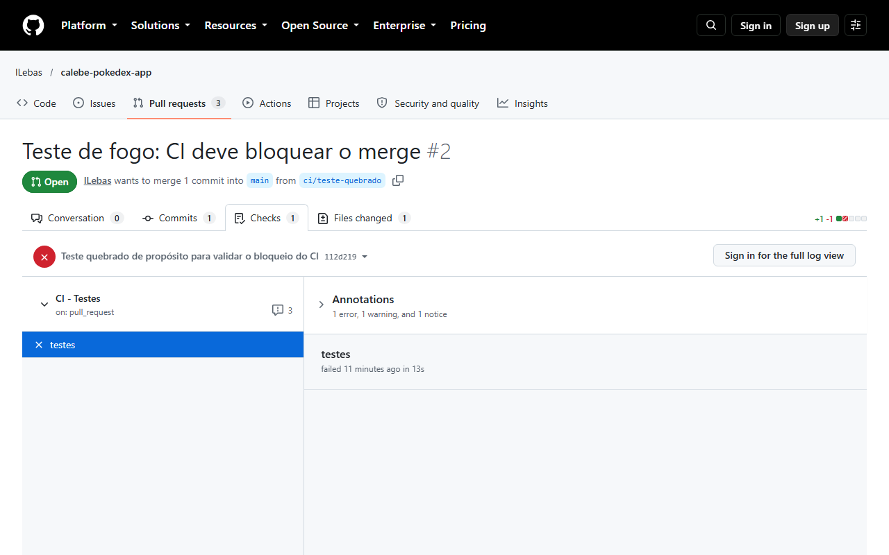

# Pokédex do Time — Bootcamp II · Etapa 03

Aplicação web para buscar Pokémon, montar e gerenciar um time persistido em banco de dados, desenvolvida com fluxo profissional (branches, Pull Requests, CI no GitHub Actions e imagem no Docker Hub).

- 🔗 Repositório: https://github.com/lLebas/calebe-pokedex-app
- 🐳 Docker Hub: https://hub.docker.com/r/<USUARIO_DOCKERHUB>/calebe-pokedex-app
- 🌐 Deploy (GitHub Pages): https://lLebas.github.io/calebe-pokedex-app/

## 1. Integrantes

| Nome | Matrícula | GitHub | Funcionalidade responsável | Principal PR |
|---|---|---|---|---|
| Calebe Xavier de Medeiros | 22609882 | @lLebas | Testes automatizados + GitHub Actions (CI) | #1 |

Padrão de branches: `feature/<nome-da-funcionalidade>` · `fix/<descricao>` · `ci/<descricao>`

## 2. Sobre a aplicação

**O que faz:** o usuário busca Pokémon por nome ou número, vê os detalhes (tipos, medidas e stats) e monta um time de até 6 Pokémon, sem repetição. O time é salvo no banco: dá para adicionar, listar e remover.

**API externa:** [PokeAPI](https://pokeapi.co/) — fornece dados, sprites, tipos e stats de cada Pokémon.

**Banco de dados:** Supabase (PostgreSQL) — tabela `time_pokemon` armazena os Pokémon do time (criar / listar / excluir).

**Stack:** HTML, CSS e JavaScript puro · Supabase JS · Jest (testes) · Nginx (container).

## 3. Como executar

### Localmente

```bash
git clone https://github.com/lLebas/calebe-pokedex-app.git
cd calebe-pokedex-app
npm install
npx serve .
```

Acesse http://localhost:3000.

Antes de rodar, preencha `SUPABASE_URL` e `SUPABASE_ANON_KEY` em `script.js`.

### Via Docker

```bash
docker run -d -p 8080:80 --name pokedex <USUARIO_DOCKERHUB>/calebe-pokedex-app:latest
```

Acesse http://localhost:8080.

A aplicação usa a chave pública (anon) do Supabase, protegida por políticas RLS, então nenhuma variável de ambiente é necessária para subir o container. A imagem é publicada automaticamente pelo workflow `.github/workflows/docker.yml` a cada push na `main`.

## 4. Como rodar os testes

```bash
npm install
npm test
```

Os 12 testes (`utils.test.js`) cobrem as funções puras de `utils.js`: `formatarNome`, `validarBusca` e `podeAdicionarAoTime` (limite de 6 e sem repetição).

O workflow `.github/workflows/ci.yml` roda os testes automaticamente em toda PR e em todo push para a `main`. O check `testes` é obrigatório: a `main` é protegida por um ruleset e só aceita merge por PR com o CI verde. Como o projeto foi feito por um único integrante, a aprovação por revisor não é exigida (o GitHub não permite aprovar a própria PR).

## 5. Evidências

### PR bloqueada pelo CI

A PR #2 foi aberta com um teste quebrado de propósito. O GitHub Actions falhou e o merge foi bloqueado:



Como a PR serviu apenas para demonstrar o bloqueio, ela foi fechada sem merge.

### Conflito de merge

Não houve conflito de merge durante o desenvolvimento: o projeto foi desenvolvido por um único integrante, com cada funcionalidade em sua própria branch e PR.
